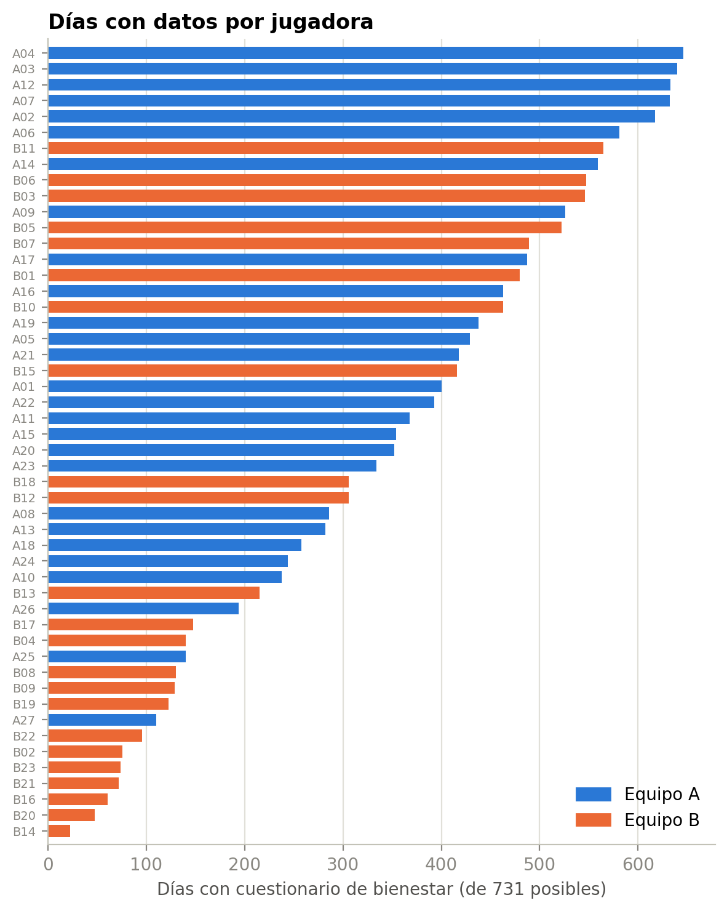
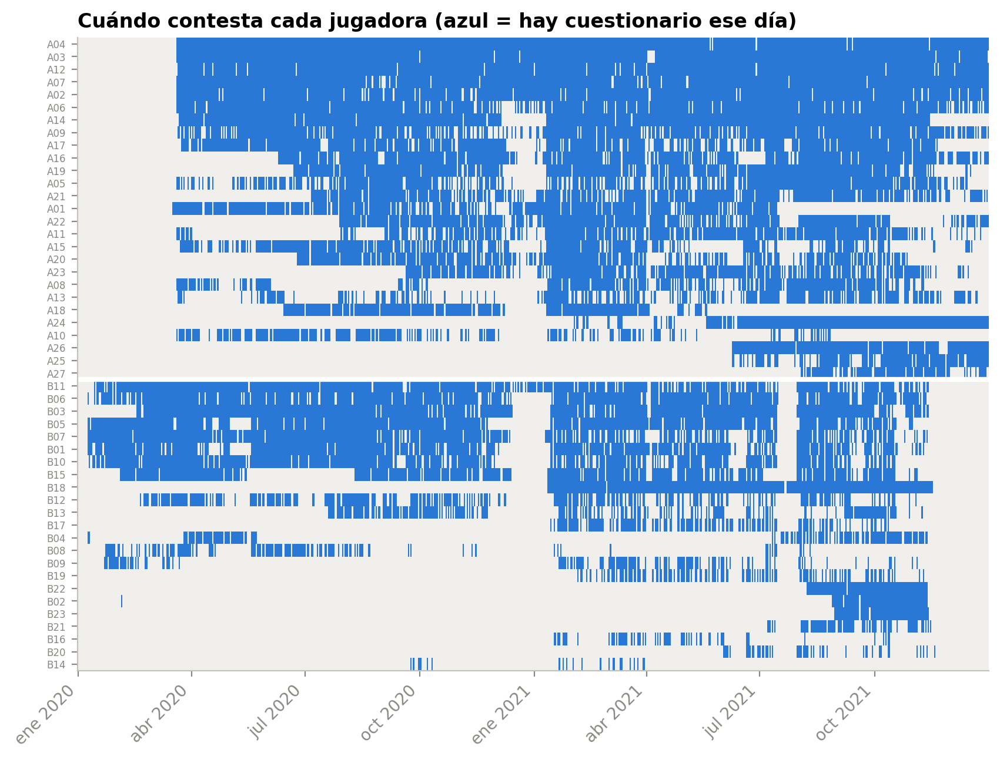
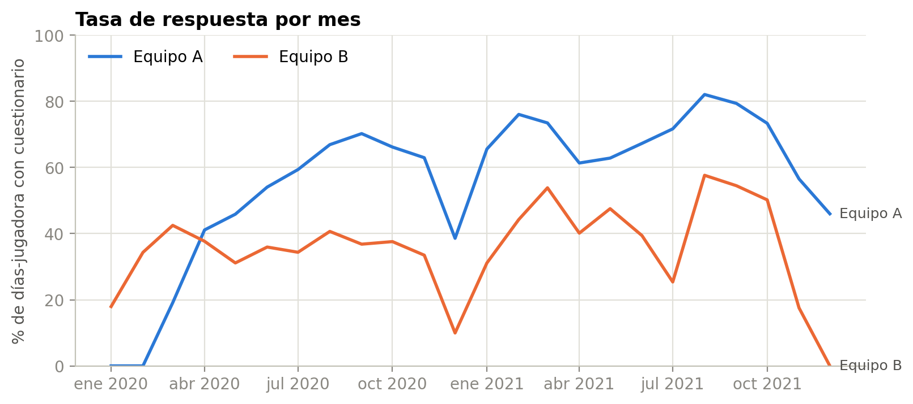
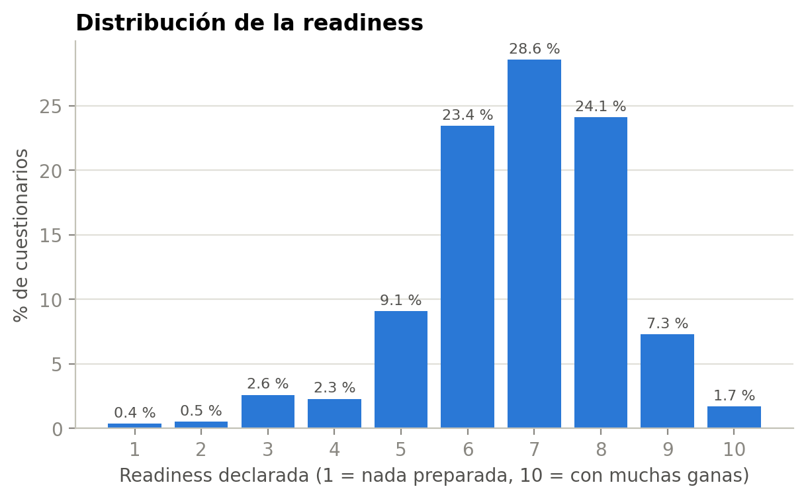
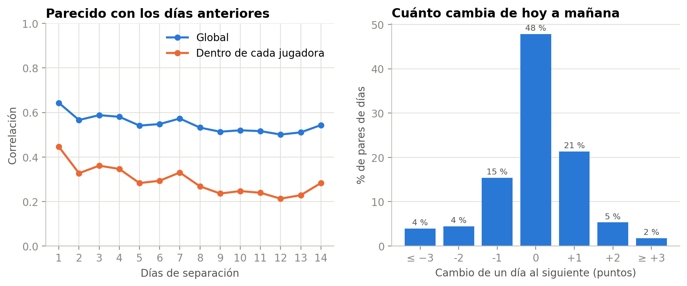
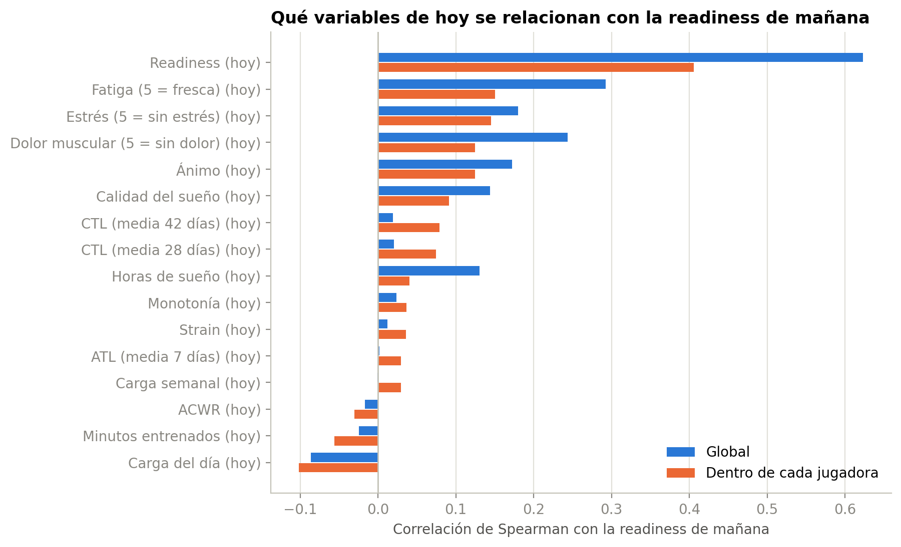
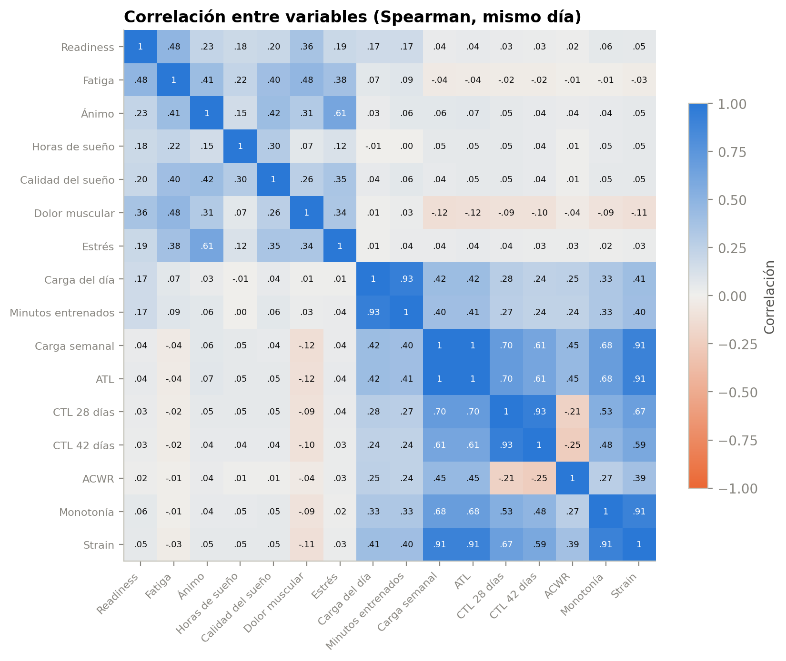
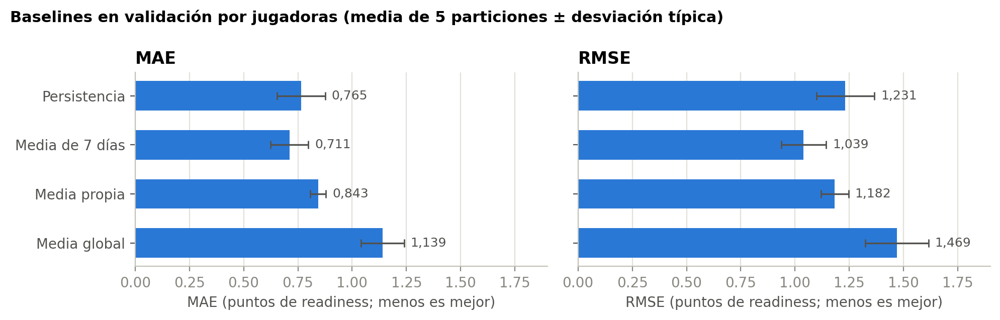
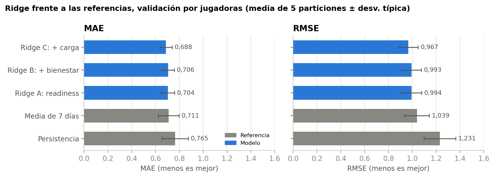
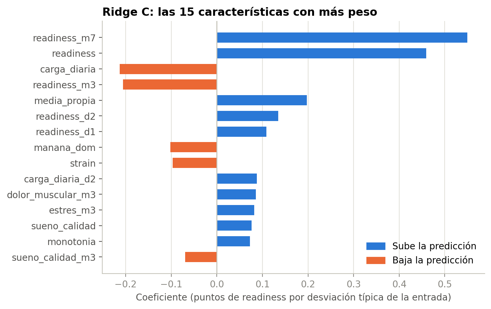

# Predictor de la disposición al entrenamiento en fútbol de élite

Práctica final de Inteligencia Artificial en las Organizaciones (UC3M, curso 2026/27). Grupo 10.

Este README hace de cuaderno de trabajo: sigue los apartados de la memoria y se actualiza en cada paso, para que al final redactarla sea pasar esto a limpio.

**Estado actual:** tabla base, análisis exploratorio, baselines, características y un primer modelo (Ridge) hechos. Pendiente: Random Forest y MLP con ajuste de hiperparámetros, y explicabilidad.

## Cómo ejecutarlo

Hace falta Python 3.11 o superior.

```bash
python3 -m venv .venv
.venv/bin/pip install -r requirements.txt
.venv/bin/python src/carga.py
.venv/bin/python src/aed.py
.venv/bin/python src/features.py
.venv/bin/python src/baselines.py
.venv/bin/python src/modelo_ridge.py
```

En Windows, sustituir `.venv/bin/` por `.venv\Scripts\`.

`carga.py` regenera `data/processed/jugadora_dia.csv` a partir de los datos crudos. `aed.py` regenera las figuras de `reports/figures/` y las tablas de `reports/tablas/`. `features.py` genera `data/processed/ejemplos.csv`, `baselines.py` evalúa las referencias y `modelo_ridge.py` el primer modelo.

## Estructura

```
data/raw/subjective/   datos originales de SoccerMon (parte subjetiva), sin modificar
data/processed/        tablas generadas por el código
src/                   código: carga.py, aed.py, features.py, validacion.py (particiones y métricas),
                       baselines.py, modelo_ridge.py
notebooks/             experimentos
reports/figures/       figuras para la memoria
reports/tablas/        los números que hay detrás de cada figura
```

---

## 1. Introducción y objetivos

**Problema.** Predecir la disposición para entrenar (*readiness*) que una futbolista declarará mañana, a partir de su carga de entrenamiento y su bienestar de los días anteriores.

- Tipo de problema: regresión supervisada sobre datos longitudinales (una serie por jugadora).
- Variable objetivo: `readiness` del día t+1, en escala de 1 a 10. Es una respuesta real del cuestionario diario, no una fórmula calculada a partir de las entradas.
- Entradas: bienestar y carga de los días hasta t.

**Objetivos.**

1. Construir y comparar modelos supervisados que mejoren a referencias sencillas (baselines).
2. Validar sin fuga de información: por jugadoras y en el tiempo.
3. Explicar qué factores pesan más en la predicción (SHAP).
4. Extensión opcional: recomendación de carga a partir de la readiness predicha.

## 2. Planteamiento y desarrollo

### 2.1 Datos

**SoccerMon** (Midoglu et al., 2024): dos equipos de la liga femenina noruega de élite, temporadas 2020 y 2021. Datos reales, recogidos con la aplicación PmSys. Solo se usa la parte subjetiva (cuestionarios); los datos de GPS quedan fuera.

| Aspecto | Valor comprobado |
|---|---|
| Jugadoras | 50 (27 del equipo A, 23 del equipo B) |
| Periodo | 1-1-2020 a 31-12-2021 (731 días) |
| Cuestionarios de bienestar | 16.997 con readiness (46,5 % de los días-jugadora) |
| Días con readiness por jugadora | de 23 a 646 |
| Sesiones de entrenamiento | 16.265 |
| Pares (día t, día t+1) con readiness en ambos | 14.631 |

#### Qué se usa y qué no

| Parte del dataset | Contenido | ¿Se usa? |
|---|---|---|
| `wellness/` (7 ficheros) | Cuestionario diario: readiness, fatiga, ánimo, horas y calidad de sueño, dolor muscular, estrés | Sí. Readiness es el objetivo; el resto, entradas |
| `training-load/session.json` | Cada sesión: duración, esfuerzo percibido (RPE) y su producto (sRPE) | Sí, resumido por día |
| `training-load/` (8 CSV) | Carga diaria y siete métricas calculadas a partir de ella por los autores | Sí, como entradas |
| `injury/`, `illness/`, `game-performance/` | 161 avisos de lesión, 14 de enfermedad y 247 valoraciones de partido | No por ahora: son informes puntuales y el alcance acordado es bienestar y carga |
| Datos objetivos (GPS, 99 GB) | Posición y movimiento en entrenamientos y partidos | No: fuera del alcance acordado |

#### Escalas y su sentido

- Readiness: de 1 («nada preparada») a 10 («con muchas ganas»).
- Fatiga, ánimo, calidad del sueño, dolor muscular y estrés: de 1 a 5.
- Duración del sueño: horas.

**En todas las escalas un valor alto es mejor.** Es fácil equivocarse con los nombres: una fatiga de 5 significa «muy fresca», no «muy cansada», y lo mismo ocurre con el dolor muscular y el estrés.

Cómo se ha comprobado:

- La Figura 2 del artículo muestra las pantallas del cuestionario: fatiga va de 1 «muy cansada» a 5 «muy fresca», y calidad del sueño de 1 «insomnio» a 5 «sueño excelente». Las pantallas de dolor muscular, estrés y ánimo no aparecen en la figura.
- Con los datos: las seis variables correlacionan en positivo con la readiness del mismo día (Spearman), también al comparar a cada jugadora consigo misma.

| Variable | Correlación con readiness | Dentro de cada jugadora |
|---|---|---|
| Fatiga | +0,48 | +0,42 |
| Dolor muscular | +0,36 | +0,31 |
| Ánimo | +0,23 | +0,21 |
| Calidad del sueño | +0,20 | +0,16 |
| Estrés | +0,19 | +0,17 |
| Horas de sueño | +0,18 | +0,10 |

Además, cuanto mayor fue la carga del día anterior, más bajos salen hoy el dolor muscular (−0,18) y la fatiga (−0,11), lo que encaja con que un valor bajo signifique «peor».

### 2.2 Fase 1: tabla jugadora-día

`src/carga.py` une los 15 ficheros CSV y el JSON de sesiones en una tabla con **una fila por jugadora y día** (36.550 filas, 23 columnas): `data/processed/jugadora_dia.csv`.

| Grupo | Columnas |
|---|---|
| Identificación | `jugadora`, `equipo`, `temporada`, `fecha` |
| Bienestar | `readiness`, `fatiga`, `animo`, `sueno_horas`, `sueno_calidad`, `dolor_muscular`, `estres`, `tiene_bienestar` |
| Sesiones del día | `n_sesiones`, `duracion_min`, `rpe_medio` |
| Carga (ya calculada en el dataset) | `carga_diaria`, `carga_semanal`, `atl`, `ctl28`, `ctl42`, `acwr`, `monotonia`, `strain` |

Decisiones y su justificación:

- **Calendario completo.** Se guardan todos los días de cada jugadora aunque no haya datos. Así la fila anterior es siempre «ayer» y los desfases no se equivocan con los huecos.
- **Día sin cuestionario = vacío.** No se rellena ni se inventa ningún valor.
- **Solo se reorganiza lo medido.** En esta fase no se crea el objetivo ni ninguna característica nueva.
- **Las métricas de carga usan solo el pasado.** Comprobado: la carga semanal es la suma de los últimos 7 días, ATL la media de 7, CTL la de 28 o 42 y ACWR es ATL entre CTL28. Todas llegan hasta el día t, así que son entradas válidas.

### 2.3 Fase 2: análisis exploratorio

`src/aed.py` genera nueve figuras y ocho tablas. No entrena nada: sirve para decidir con datos.

#### Cuántos datos hay y dónde están los huecos







- **Los huecos no son aleatorios.** El equipo A no empieza a registrar hasta mediados de marzo de 2020 y el equipo B deja de hacerlo a mediados de noviembre de 2021. Ambos caen en diciembre, entre temporadas, y hay jugadoras que solo aparecen una de las dos.
- **Dentro de su periodo activo, cada jugadora contesta bastante.** Sobre los 731 días la cobertura es del 46,5 %, pero entre su primer y su último cuestionario la mediana es del 73,5 % (de 11,7 % a 99,1 %).
- **El equipo A contesta más** que el B casi todos los meses.
- **Cuando hay cuestionario, está completo.** Menos del 0,2 % de valores ausentes en cada variable de bienestar.

#### Cómo es la readiness




- **Está concentrada en la zona media-alta.** Media 6,80 y mediana 7; el 92,5 % de las respuestas está entre 5 y 9 y solo el 3,5 % es 3 o menos. Los días malos, que son los más interesantes, son pocos.
- **Cada jugadora tiene su nivel.** Las medias individuales van de 4,87 a 8,59. La desviación entre jugadoras (0,79) es comparable a la variación de una misma jugadora de un día a otro (1,17).

#### Cuánto se parece a los días anteriores



- **Mucho, y de forma duradera.** La correlación con el día anterior es 0,64 y a 14 días sigue en 0,54. Esa parte que no decae es el nivel propio de cada jugadora.
- **Quitando ese nivel, la memoria es corta.** Comparando a cada jugadora consigo misma, la correlación baja a 0,45 con el día anterior y a 0,33 con dos días antes.
- **Casi la mitad de los días no cambia.** El 47,8 % de las veces la readiness de mañana es igual a la de hoy, y el 84,6 % cambia como mucho un punto.

#### Qué se relaciona con la readiness de mañana





- **Lo que más informa es la readiness de hoy** (0,62; 0,41 dentro de cada jugadora), seguida del bienestar de hoy: fatiga, estrés, dolor muscular y ánimo (entre 0,12 y 0,15 dentro de cada jugadora).
- **La carga de entrenamiento se relaciona poco.** Ninguna métrica de carga pasa de 0,10 en valor absoluto. La más clara es la carga del día: a más carga hoy, algo menos de readiness mañana (−0,10).
- **Hay entradas redundantes.** La carga semanal y el ATL son la misma información (correlación 1,00: una es la suma de 7 días y la otra su media). También van casi juntas CTL de 28 y de 42 días (0,93), minutos y carga del día (0,93), y strain con carga semanal y con monotonía (0,91).


- **Hay respuestas repetidas durante semanas.** La jugadora A04 contesta 3 casi todos los días desde abril de 2021. En conjunto, el 5,6 % de los cuestionarios pertenece a rachas de 14 o más días seguidos con el mismo valor (8 jugadoras). En esos tramos la persistencia acierta siempre, sin que eso signifique capacidad de predicción.
- **La persistencia funciona muy distinto según la jugadora.** El porcentaje de días sin cambio va del 19 % al 95 %, y el MAE de la persistencia por jugadora de 0,10 a 1,82.

#### Cuántos ejemplos quedan según el tratamiento de los huecos

| Criterio | Ejemplos | % | Jugadoras |
|---|---|---|---|
| Readiness hoy y mañana (mínimo imprescindible) | 14.631 | 100 | 50 |
| + cuestionario ayer | 12.987 | 88,8 | 50 |
| + ayer y anteayer | 11.769 | 80,4 | 49 |
| + al menos 4 de los últimos 7 días | 13.897 | 95,0 | 49 |
| + los 7 últimos días completos | 8.872 | 60,6 | 46 |

| Mínimo de pares por jugadora | Jugadoras | Pares | % |
|---|---|---|---|
| 1 | 50 | 14.631 | 100 |
| 30 | 47 | 14.576 | 99,6 |
| 60 | 45 | 14.471 | 98,9 |
| 100 | 38 | 13.909 | 95,1 |

#### Qué implica para el diseño (propuestas, pendientes de acordar)

- **Usar el pasado de la propia jugadora como entrada** (su media hasta la fecha), porque su nivel habitual explica buena parte de la readiness.
- **No exigir los 7 días anteriores completos**, que tiraría el 39 % de los ejemplos. Calcular las medias móviles con los días disponibles y pedir un mínimo.
- **Quitar entradas duplicadas** (carga semanal o ATL, una de las dos CTL) o justificar por qué se dejan.
- **Esperar una mejora moderada sobre la persistencia** y analizarla por jugadora, no solo en media.

### 2.4 Esquema de validación

`src/validacion.py` contiene lo que comparten baselines y modelos, para que todo se evalúe igual: los mismos ejemplos, las mismas particiones y las mismas métricas.

- **Ejemplos.** Un ejemplo es un día t de una jugadora en el que se conoce su readiness y la del día siguiente: 14.631 ejemplos de 50 jugadoras.
- **Validación principal: por jugadoras.** Validación cruzada de 5 particiones en la que todas las filas de una jugadora caen en la misma partición (`GroupKFold`). Cada partición evalúa 10 jugadoras que no se han visto al entrenar, con unos 2.900 ejemplos. Sin esto el modelo podría reconocer a la jugadora y el error saldría optimista.
- **Comprobación temporal.** Entrenar con la temporada 2020 (6.231 ejemplos) y evaluar en la 2021 (8.400).
- **Métricas.** MAE (error medio en puntos de readiness), RMSE (castiga más los errores grandes) y R² como apoyo.

### 2.5 Baselines

Un baseline es una forma de predecir tan simple que no necesita aprendizaje automático. Si un modelo no lo mejora, no aporta nada. `src/baselines.py` evalúa cuatro:

| Baseline | Qué predice para mañana |
|---|---|
| Media global | La media de la readiness en los datos de entrenamiento |
| Media propia | La media de todos los cuestionarios de esa jugadora hasta hoy |
| Media de 7 días | La media de sus últimos 7 días (con los que haya) |
| Persistencia | Lo mismo que hoy |

Los tres últimos solo usan el pasado de la propia jugadora, así que sirven también para una jugadora nueva.

### 2.6 Objetivo y características

`src/features.py` convierte la tabla jugadora-día en ejemplos para aprendizaje supervisado y los guarda en `data/processed/ejemplos.csv` (14.631 filas, 56 características). Todas las características usan solo información de días anteriores o iguales a t.

| Bloque | Nº | Contenido |
|---|---|---|
| Historial de readiness | 6 | Hoy, ayer, anteayer, media de 3 y de 7 días, y media propia hasta la fecha |
| Contexto | 11 | Si hay cuestionario ayer y anteayer, días con datos en la última semana, cuestionarios acumulados y día de la semana de mañana |
| Bienestar | 30 | Las seis variables restantes del cuestionario: hoy, ayer, anteayer, media de 3 y de 7 días |
| Carga | 9 | Carga de hoy, de ayer y de anteayer, media de 3 días, ATL, CTL de 28 días, ACWR, monotonía y strain |

Decisiones:

- **No se descarta ningún ejemplo por huecos.** Los desfases sin dato (un 11-12 % de los ejemplos) se dejan vacíos y se rellenan con la mediana dentro de la validación, ajustada solo con los datos de entrenamiento. Dos columnas indican si había dato real.
- **Las medias móviles se calculan con los días disponibles.** Como el día t siempre tiene cuestionario, nunca quedan vacías.
- **Se quitan las métricas de carga duplicadas**: carga semanal (es ATL por 7), CTL de 42 días y minutos entrenados.
- **Los baselines y los modelos usan exactamente las mismas 14.631 filas.**

### 2.7 Primer modelo: regresión Ridge

`src/modelo_ridge.py`. Es una regresión lineal con regularización: una suma ponderada de las características. Se entrena tres veces, añadiendo un bloque cada vez, para ver qué aporta cada uno. El relleno de vacíos y el escalado van dentro de un `Pipeline`, de modo que se ajustan solo con los datos de entrenamiento de cada partición. Aún sin ajuste de hiperparámetros (alpha = 1).

### 2.8 Fases siguientes

Pendiente: Random Forest y MLP con ajuste de hiperparámetros dentro de la validación, y SHAP.

## 3. Resultados

### 3.1 Baselines



Validación por jugadoras (media de 5 particiones ± desviación típica):

| Baseline | MAE | RMSE | R² |
|---|---|---|---|
| Media global | 1,139 ± 0,100 | 1,469 ± 0,145 | −0,05 |
| Media propia | 0,843 ± 0,036 | 1,182 ± 0,063 | 0,31 |
| Persistencia | 0,765 ± 0,111 | 1,231 ± 0,133 | 0,22 |
| **Media de 7 días** | **0,711 ± 0,088** | **1,039 ± 0,103** | **0,45** |

Comprobación temporal (entrenar con 2020, evaluar en 2021):

| Baseline | MAE | RMSE | R² |
|---|---|---|---|
| Media global | 1,141 | 1,517 | 0,00 |
| Media propia | 0,855 | 1,220 | 0,35 |
| Persistencia | 0,736 | 1,194 | 0,38 |
| **Media de 7 días** | **0,692** | **1,027** | **0,54** |

**La referencia a batir es la media de 7 días**, no la persistencia: gana en las dos métricas y en los dos esquemas. Un modelo tendrá que bajar de MAE 0,711 y RMSE 1,039.

Dónde falla cada uno (MAE, validación por jugadoras):

| Baseline | Mañana = hoy | Mañana ≠ hoy | Readiness baja (1-4) | Media (5-7) | Alta (8-10) |
|---|---|---|---|---|---|
| Media global | 1,105 | 1,171 | 3,614 | 0,678 | 1,532 |
| Media propia | 0,672 | 0,999 | 2,720 | 0,674 | 0,814 |
| Media de 7 días | 0,387 | 1,008 | 1,580 | 0,633 | 0,696 |
| Persistencia | 0,000 | 1,466 | 1,485 | 0,754 | 0,656 |

- **La persistencia acierta siempre que no hay cambio y falla mucho cuando lo hay** (1,47 puntos de media). Promediar 7 días reparte mejor el error.
- **Todos fallan más en los días malos.** Cuando la readiness real es de 4 o menos, el mejor baseline se equivoca en 1,5 puntos. Son pocos días, pero son los que más interesaría anticipar.
- **No hay un baseline que gane para todas las jugadoras.** La media de 7 días es la mejor en 19, la persistencia en 14, la media propia en 11 y la media global en 6.

### 3.2 Primer modelo (Ridge)



Validación por jugadoras (media de 5 particiones ± desviación típica):

| Método | MAE | RMSE | R² |
|---|---|---|---|
| Persistencia | 0,765 ± 0,111 | 1,231 ± 0,133 | 0,22 |
| Media de 7 días | 0,711 ± 0,088 | 1,039 ± 0,103 | 0,45 |
| Ridge A: readiness y contexto | 0,704 ± 0,057 | 0,994 ± 0,085 | 0,50 |
| Ridge B: + bienestar | 0,706 ± 0,053 | 0,993 ± 0,083 | 0,50 |
| **Ridge C: + carga** | **0,688 ± 0,051** | **0,967 ± 0,082** | **0,52** |

Comprobación temporal (entrenar con 2020, evaluar en 2021):

| Método | MAE | RMSE | R² |
|---|---|---|---|
| Persistencia | 0,736 | 1,194 | 0,38 |
| Media de 7 días | 0,692 | 1,027 | 0,54 |
| Ridge C: + carga | 0,693 | 0,976 | 0,59 |

Comparaciones estadísticas (diferencia de MAE; negativa = gana el primero):

| Comparación | Diferencia | t-test pareado (5 particiones) | Wilcoxon (50 jugadoras) | Jugadoras en que gana |
|---|---|---|---|---|
| Ridge C frente a media de 7 días | −0,023 | p = 0,39 | p = 0,001 | 37 de 50 |
| Ridge C frente a persistencia | −0,077 | p = 0,06 | p < 0,001 | 38 de 50 |
| Ridge B frente a Ridge A (añadir bienestar) | +0,002 | p = 0,50 | p = 0,54 | 26 de 50 |
| Ridge C frente a Ridge B (añadir carga) | −0,018 | p = 0,047 | p < 0,001 | 37 de 50 |

Lectura:

- **El modelo mejora al mejor baseline, pero por poco.** El MAE baja un 3 % y el RMSE un 7 % respecto a la media de 7 días. La mejora es clara en RMSE y por jugadora (gana en 37 de 50), pero no es significativa con el t-test sobre las cinco particiones, y en la comprobación temporal el MAE empata.
- **La carga de entrenamiento sí aporta.** Añadirla baja el error de forma significativa en las dos pruebas. En el AED su correlación con la readiness de mañana era baja (−0,10), pero combinada con el resto de entradas resulta útil.
- **El resto del bienestar no aporta** una vez que el modelo ya conoce el historial de readiness.



- **Lo que más pesa** es la media de readiness de 7 días y la readiness de hoy. La tercera es la carga de hoy, en negativo: tras un día de mucha carga, el modelo predice menos readiness.
- **El domingo baja la predicción.** Si mañana es domingo, el modelo resta readiness.
- **Cuidado al interpretar coeficientes sueltos.** Varias entradas están muy correlacionadas (por ejemplo las medias de 3 y 7 días), y el modelo reparte el peso entre ellas con signos opuestos.

Dónde falla (MAE, validación por jugadoras):

| Método | Mañana = hoy | Mañana ≠ hoy | Readiness baja (1-4) | Media (5-7) | Alta (8-10) |
|---|---|---|---|---|---|
| Persistencia | 0,000 | 1,466 | 1,485 | 0,754 | 0,656 |
| Media de 7 días | 0,387 | 1,008 | 1,580 | 0,633 | 0,696 |
| Ridge C | 0,416 | 0,937 | 1,758 | 0,580 | 0,693 |

- **Ridge gana en los días normales y pierde en los malos.** Es el mejor cuando la readiness real está entre 5 y 7 y cuando hay cambio, pero el peor cuando es 4 o menos: tiende a predecir valores cercanos a la media.

## 4. Análisis y discusión

Limitaciones conocidas hasta ahora:

- **Huecos.** Más de la mitad de los días-jugadora no tiene cuestionario, y el reparto entre jugadoras es muy desigual.
- **Ceros ambiguos en la carga.** Un 0 no distingue «no entrenó» de «no lo registró».
- **Pequeñas incoherencias en el origen.** En 110 de 14.197 días con sesión, la carga diaria del dataset no coincide con la suma de sus sesiones; hay 76 sesiones repetidas; el strain no se reproduce exactamente con la fórmula habitual.
- **Respuestas repetidas.** Algunas jugadoras contestan el mismo valor durante semanas, lo que favorece a la persistencia.
- **Cuestionarios con retraso.** La aplicación permite contestar por días anteriores, así que parte de las respuestas pueden ser de memoria.
- **Pocos días malos.** Solo el 3,5 % de las respuestas es 3 o menos.
- **Datos subjetivos** de solo dos equipos femeninos de una liga.

## 5. Conclusiones

Pendiente.

## 6. Referencias

- Midoglu, C. et al. (2024). A large-scale multivariate soccer athlete health, performance, and position monitoring dataset. *Scientific Data*, 11, 553. https://doi.org/10.1038/s41597-024-03386-x
- Midoglu, C. et al. (2022). SoccerMon [conjunto de datos]. Zenodo. https://doi.org/10.5281/zenodo.10033832
- Impellizzeri, F. M. et al. (2004). Use of RPE-based training load in soccer. *Medicine & Science in Sports & Exercise*, 36, 1042–1047.

## Licencia de los datos

Los ficheros de `data/raw/subjective/` pertenecen al conjunto de datos SoccerMon, de Midoglu et al., publicado con licencia [CC BY 4.0](https://creativecommons.org/licenses/by/4.0/). Se incluyen sin modificar.
