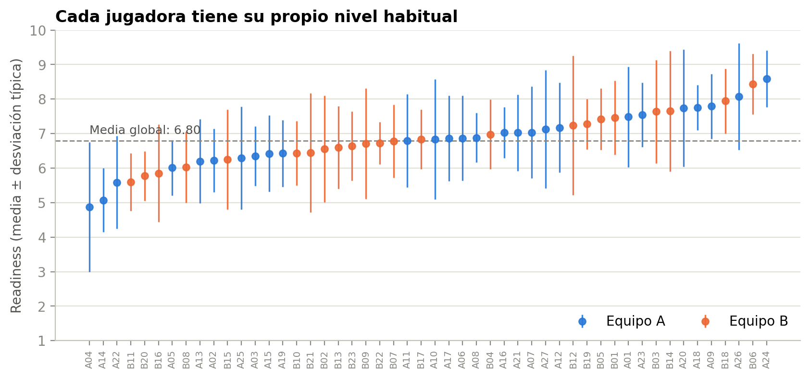
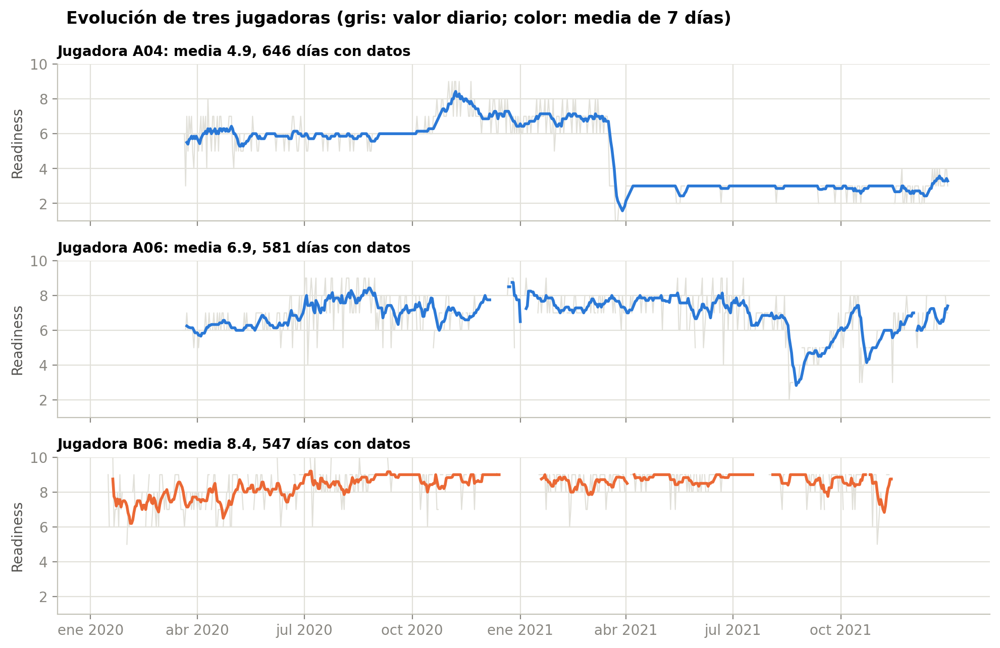
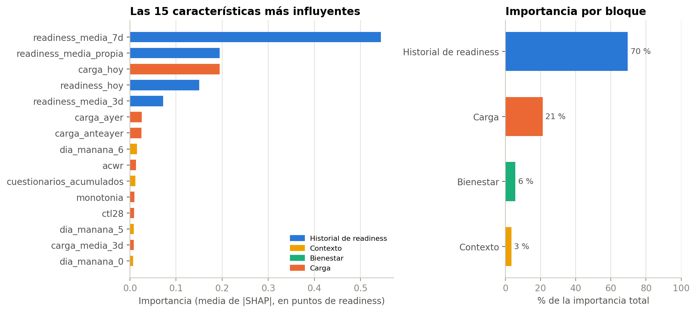
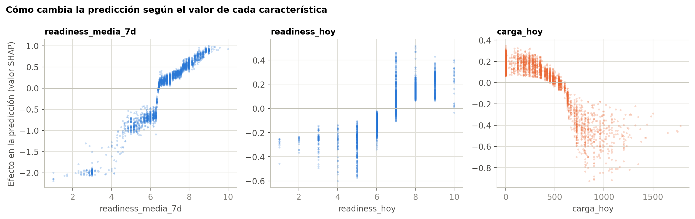
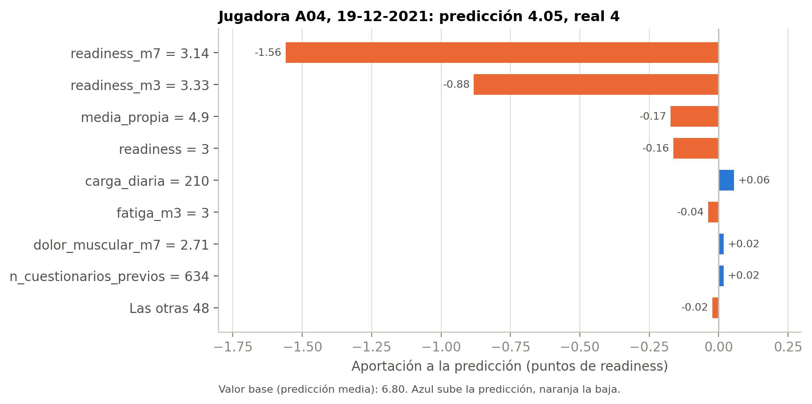
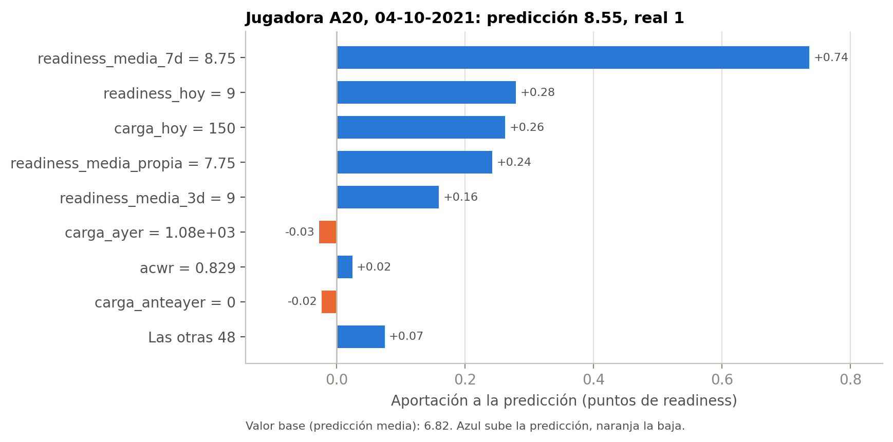
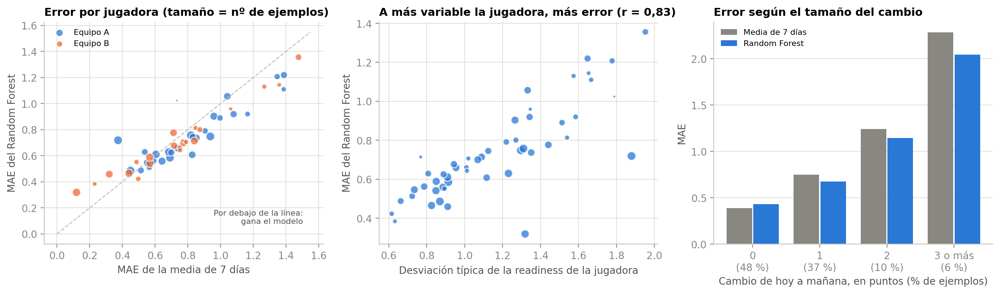

# Predictor de la disposición al entrenamiento en fútbol de élite

Práctica final de Inteligencia Artificial en las Organizaciones (UC3M, curso 2026/27). Grupo 10.

Se predice la disposición para entrenar (*readiness*, de 1 a 10) que una futbolista declarará mañana, a partir de su bienestar y su carga de entrenamiento hasta hoy, con datos reales de dos equipos de élite (SoccerMon). Los modelos se comparan con referencias sencillas, se validan con jugadoras no vistas y en una temporada posterior, y se explican con SHAP. Además, se plantea como clasificación para detectar los días malos.

## Herramientas

El proyecto combina Altair AI Studio y Python. Cada paso tiene una herramienta principal:

| Paso | Herramienta | Dónde |
|---|---|---|
| Construir la tabla jugadora-día | Python, ejecutado desde Altair | `src/carga.py` · proceso `01_Ingesta_y_Limpieza` |
| Análisis exploratorio | Python (completo) y Altair (vistas principales) | `src/aed.py` · proceso `02_AED_Exploracion` |
| Construir las 56 características | Python, ejecutado desde Altair | `src/features.py` · proceso `03_Ingenieria_Caracteristicas` |
| Referencias, modelos (Ridge, Random Forest, red neuronal), validación por jugadoras, ANOVA y t-test | Altair | proceso `04_Baselines_y_Modelado` |
| Validación temporal 2020 → 2021 | Altair | proceso `05_Validacion_Temporal_2020_2021` |
| Importancia de variables y error por franja de readiness | Altair | proceso `06_Explicabilidad_y_Errores` |
| Clasificación de días malos | Altair | proceso `07_Clasificacion_Dia_Malo` |
| AUC de las reglas de referencia en la clasificación | Python | `src/clasificacion_referencias.py` |
| Contraste pareado por jugadora (Wilcoxon) | Python | `src/contraste_jugadoras.py` |
| Explicabilidad con SHAP | Python | `src/explicabilidad.py` |
| Análisis de errores detallado | Python | `src/analisis_errores.py` |
| Análisis de sensibilidad | Python | `src/sensibilidad.py` |

**Los modelos se entrenan y evalúan en Altair.** Python se usa para preparar los datos (los mismos scripts que ejecuta Altair) y para los análisis que Altair no ofrece: la prueba de Wilcoxon, SHAP, repetir la validación cambiando una cosa cada vez y el AUC de las reglas de referencia en la clasificación.

**Por qué hay modelos en Python (`src/modelo_altair.py`).** SHAP y la prueba de Wilcoxon necesitan tener el modelo en Python: SHAP tiene que recorrer los árboles del Random Forest, y Wilcoxon necesita el error de cada jugadora, que hay que calcular repitiendo la validación. Un modelo guardado por Altair no se puede abrir desde Python, así que `modelo_altair.py` define Ridge y Random Forest **con la misma configuración que en Altair** (mismo relleno de huecos, mismo escalado, mismos hiperparámetros y misma semilla). `contraste_jugadoras.py` comprueba que dan los mismos errores: media de 7 días 1,081 en las dos herramientas, Ridge 1,002 en las dos y Random Forest 0,994 en Python frente a 0,995 en Altair (RMSE). Así, lo que se explica con SHAP y se contrasta con Wilcoxon es el mismo modelo que se evalúa en Altair.

La guía de los procesos de Altair está en [`ALTAIR.md`](ALTAIR.md).

## Cómo ejecutarlo

**En Altair AI Studio:** seguir [`ALTAIR.md`](ALTAIR.md).

**En Python** (hace falta Python 3.11 o superior):

```bash
python3 -m venv .venv
.venv/bin/pip install -r requirements.txt
.venv/bin/python src/carga.py
.venv/bin/python src/aed.py
.venv/bin/python src/features.py
.venv/bin/python src/contraste_jugadoras.py   # tarda un minuto
.venv/bin/python src/analisis_errores.py
.venv/bin/python src/explicabilidad.py
.venv/bin/python src/sensibilidad.py          # unos cinco minutos
.venv/bin/python src/clasificacion_referencias.py
```

En Windows, sustituir `.venv/bin/` por `.venv\Scripts\`.

- `carga.py` genera `data/processed/jugadora_dia.csv` a partir de los datos crudos.
- `aed.py` genera las figuras 01 a 09 y sus tablas.
- `features.py` genera `data/processed/ejemplos.csv`.
- `contraste_jugadoras.py` repite la validación por jugadoras de Altair con las cuatro referencias, hace la prueba de Wilcoxon y guarda la predicción de cada día.
- `analisis_errores.py` analiza esas predicciones y genera la figura 19.
- `explicabilidad.py` calcula SHAP y genera las figuras 15 a 18.
- `sensibilidad.py` repite la validación quitando las notas repetidas, añadiendo si el equipo entrenó y quitando el strain.
- `clasificacion_referencias.py` calcula el AUC de las dos reglas de referencia de la clasificación.

## Estructura

```
data/raw/subjective/   datos originales de SoccerMon (parte subjetiva), sin modificar
data/processed/        tablas generadas: .csv (Python) y .rmhdf5table (Altair)
processes/             procesos de Altair AI Studio (01 a 07)
models/                modelos guardados por Altair
src/                   código Python: carga.py, features.py, aed.py,
                       modelo_altair.py, contraste_jugadoras.py,
                       analisis_errores.py, explicabilidad.py, sensibilidad.py,
                       clasificacion_referencias.py
reports/figures/       figuras generadas con Python
reports/altair/        figuras exportadas desde Altair
reports/tablas/        los números que hay detrás de cada figura
```

---

## 1. Introducción y objetivos

**Problema.** Predecir la disposición para entrenar (*readiness*) que una futbolista declarará mañana, a partir de su carga de entrenamiento y su bienestar de los días anteriores.

- Tipo de problema: regresión supervisada sobre datos longitudinales (una serie por jugadora) y, como complemento, clasificación de días malos.
- Variable objetivo: `readiness` del día t+1, en escala de 1 a 10. Es una respuesta real del cuestionario diario, no una fórmula calculada a partir de las entradas.
- Entradas: bienestar y carga de los días hasta t.

**Objetivos.**

1. Construir y comparar modelos supervisados que mejoren a referencias sencillas (baselines).
2. Validar sin fuga de información: por jugadoras y en el tiempo.
3. Explicar qué factores pesan más en la predicción (SHAP).
4. Analizar dónde y por qué falla el modelo.
5. Comprobar si, planteado como clasificación, se detectan mejor los días malos.

## 2. Planteamiento y desarrollo

### 2.1 Datos

**SoccerMon** (Midoglu et al., 2024): dos equipos de la liga femenina noruega de élite, temporadas 2020 y 2021. Datos reales, recogidos con la aplicación PmSys. Solo se usa la parte subjetiva (cuestionarios); los datos de GPS quedan fuera.

| Aspecto | Valor comprobado |
|---|---|
| Jugadoras | 50 (27 del equipo A, 23 del equipo B) |
| Periodo | 1-1-2020 a 31-12-2021 (731 días) |
| Cuestionarios de bienestar | 16.997 con readiness (46,5 % de los días-jugadora) |
| Días con readiness por jugadora | de 23 a 646 |
| Sesiones de entrenamiento | 16.265 |
| Pares (día t, día t+1) con readiness en ambos | 14.631 |

#### Qué se usa y qué no

| Parte del dataset | Contenido | ¿Se usa? |
|---|---|---|
| `wellness/` (7 ficheros) | Cuestionario diario: readiness, fatiga, ánimo, horas y calidad de sueño, dolor muscular, estrés | Sí. Readiness es el objetivo; el resto, entradas |
| `training-load/session.json` | Cada sesión: duración, esfuerzo percibido (RPE) y su producto (sRPE) | Sí, resumido por día |
| `training-load/` (8 CSV) | Carga diaria y siete métricas calculadas a partir de ella por los autores | Sí, como entradas |
| `injury/`, `illness/`, `game-performance/` | 161 avisos de lesión, 14 de enfermedad y 247 valoraciones de partido | No: son informes puntuales y el alcance del proyecto es bienestar y carga |
| Datos objetivos (GPS, 99 GB) | Posición y movimiento en entrenamientos y partidos | No: fuera del alcance del proyecto |

#### Escalas y su sentido

- Readiness: de 1 («nada preparada») a 10 («con muchas ganas»).
- Fatiga, ánimo, calidad del sueño, dolor muscular y estrés: de 1 a 5.
- Duración del sueño: horas.

**En todas las escalas un valor alto es mejor.** Es fácil equivocarse con los nombres: una fatiga de 5 significa «muy fresca», no «muy cansada», y lo mismo ocurre con el dolor muscular y el estrés.

Cómo se ha comprobado:

- La Figura 2 del artículo muestra las pantallas del cuestionario: fatiga va de 1 «muy cansada» a 5 «muy fresca», y calidad del sueño de 1 «insomnio» a 5 «sueño excelente». Las pantallas de dolor muscular, estrés y ánimo no aparecen en la figura.
- Con los datos: las seis variables correlacionan en positivo con la readiness del mismo día (Spearman), también al comparar a cada jugadora consigo misma.

| Variable | Correlación con readiness | Dentro de cada jugadora |
|---|---|---|
| Fatiga | +0,48 | +0,42 |
| Dolor muscular | +0,36 | +0,31 |
| Ánimo | +0,23 | +0,21 |
| Calidad del sueño | +0,20 | +0,16 |
| Estrés | +0,19 | +0,17 |
| Horas de sueño | +0,18 | +0,10 |

Además, cuanto mayor fue la carga del día anterior, más bajos salen hoy el dolor muscular (−0,18) y la fatiga (−0,11), lo que encaja con que un valor bajo signifique «peor».

### 2.2 Tabla jugadora-día

`src/carga.py` (ejecutado desde Altair en el proceso `01_Ingesta_y_Limpieza`) une los 15 ficheros CSV y el JSON de sesiones en una tabla con **una fila por jugadora y día** (36.550 filas, 23 columnas): `data/processed/jugadora_dia.csv`.

| Grupo | Columnas |
|---|---|
| Identificación | `jugadora`, `equipo`, `temporada`, `fecha` |
| Bienestar | `readiness`, `fatiga`, `animo`, `sueno_horas`, `sueno_calidad`, `dolor_muscular`, `estres`, `tiene_bienestar` |
| Sesiones del día | `n_sesiones`, `duracion_min`, `rpe_medio` |
| Carga (ya calculada en el dataset) | `carga_diaria`, `carga_semanal`, `atl`, `ctl28`, `ctl42`, `acwr`, `monotonia`, `strain` |

Decisiones y su justificación:

- **Calendario completo.** Se guardan todos los días de cada jugadora aunque no haya datos. Así la fila anterior es siempre «ayer» y los desfases no se equivocan con los huecos.
- **Día sin cuestionario = vacío.** No se rellena ni se inventa ningún valor.
- **Solo se reorganiza lo medido.** En este paso no se crea el objetivo ni ninguna característica nueva.
- **Las métricas de carga usan solo el pasado.** Comprobado: la carga semanal es la suma de los últimos 7 días, ATL la media de 7, CTL la de 28 o 42 y ACWR es ATL entre CTL28. Todas llegan hasta el día t, así que son entradas válidas.

### 2.3 Análisis exploratorio

`src/aed.py` genera nueve figuras y ocho tablas. No entrena nada: sirve para decidir con datos.

El proceso `02_AED_Exploracion` de Altair reproduce las vistas principales sobre la misma tabla jugadora-día: distribución de la readiness, media y dispersión por jugadora, cobertura, matriz de correlaciones y autocorrelación con el día anterior (figuras en `reports/altair/`). El análisis completo está en Python porque incluye cálculos que en Altair requieren mucho más trabajo: correlaciones con la readiness del día siguiente y dentro de cada jugadora, autocorrelación hasta 14 días, rachas de notas repetidas y cuántos ejemplos quedan según el tratamiento de los huecos.

#### Cuántos datos hay y dónde están los huecos


- **Los huecos no son aleatorios.** El equipo A no empieza a registrar hasta mediados de marzo de 2020 y el equipo B deja de hacerlo a mediados de noviembre de 2021. Ambos caen en diciembre, entre temporadas, y hay jugadoras que solo aparecen una de las dos.
- **Dentro de su periodo activo, cada jugadora contesta bastante.** Sobre los 731 días la cobertura es del 46,5 %, pero entre su primer y su último cuestionario la mediana es del 73,5 % (de 11,7 % a 99,1 %).
- **El equipo A contesta más** que el B casi todos los meses.
- **Cuando hay cuestionario, está completo.** Menos del 0,2 % de valores ausentes en cada variable de bienestar.

#### Cómo es la readiness




- **Está concentrada en la zona media-alta.** Media 6,80 y mediana 7; el 92,5 % de las respuestas está entre 5 y 9 y solo el 3,5 % es 3 o menos. Los días malos, que son los más interesantes, son pocos.
- **Cada jugadora tiene su nivel.** Las medias individuales van de 4,87 a 8,59. La desviación entre jugadoras (0,79) es comparable a la variación de una misma jugadora de un día a otro (1,17).

#### Cuánto se parece a los días anteriores


- **Mucho, y de forma duradera.** La correlación con el día anterior es 0,64 y a 14 días sigue en 0,54. Esa parte que no decae es el nivel propio de cada jugadora.
- **Quitando ese nivel, la memoria es corta.** Comparando a cada jugadora consigo misma, la correlación baja a 0,45 con el día anterior y a 0,33 con dos días antes.
- **Casi la mitad de los días no cambia.** El 47,8 % de las veces la readiness de mañana es igual a la de hoy, y el 84,6 % cambia como mucho un punto.

#### Qué se relaciona con la readiness de mañana


- **Lo que más informa es la readiness de hoy** (0,62; 0,41 dentro de cada jugadora), seguida del bienestar de hoy: fatiga, estrés, dolor muscular y ánimo (entre 0,12 y 0,15 dentro de cada jugadora).
- **La carga de entrenamiento se relaciona poco.** Ninguna métrica de carga pasa de 0,10 en valor absoluto. La más clara es la carga del día: a más carga hoy, algo menos de readiness mañana (−0,10).
- **Hay entradas redundantes.** La carga semanal y el ATL son la misma información (correlación 1,00: una es la suma de 7 días y la otra su media). También van casi juntas CTL de 28 y de 42 días (0,93), minutos y carga del día (0,93), y strain con carga semanal y con monotonía (0,91).



- **Hay respuestas repetidas durante semanas.** La jugadora A04 contesta 3 casi todos los días desde abril de 2021. En conjunto, el 5,6 % de los cuestionarios pertenece a rachas de 14 o más días seguidos con el mismo valor (8 jugadoras). En esos tramos la persistencia acierta siempre, sin que eso signifique capacidad de predicción.
- **La persistencia funciona muy distinto según la jugadora.** El porcentaje de días sin cambio va del 19 % al 95 %, y el MAE de la persistencia por jugadora de 0,10 a 1,82.

#### Cuántos ejemplos quedan según el tratamiento de los huecos

| Criterio | Ejemplos | % | Jugadoras |
|---|---|---|---|
| Readiness hoy y mañana (mínimo imprescindible) | 14.631 | 100 | 50 |
| + cuestionario ayer | 12.987 | 88,8 | 50 |
| + ayer y anteayer | 11.769 | 80,4 | 49 |
| + al menos 4 de los últimos 7 días | 13.897 | 95,0 | 49 |
| + los 7 últimos días completos | 8.872 | 60,6 | 46 |

| Mínimo de pares por jugadora | Jugadoras | Pares | % |
|---|---|---|---|
| 1 | 50 | 14.631 | 100 |
| 30 | 47 | 14.576 | 99,6 |
| 60 | 45 | 14.471 | 98,9 |
| 100 | 38 | 13.909 | 95,1 |

#### Qué implica para el diseño

- **Usar el pasado de la propia jugadora como entrada** (su media hasta la fecha y la de los últimos días), porque su nivel habitual explica buena parte de la readiness.
- **No exigir los 7 días anteriores completos**, que tiraría el 39 % de los ejemplos. Las medias móviles se calculan con los días disponibles.
- **Quitar entradas duplicadas**: carga semanal (es ATL por 7), CTL de 42 días y minutos entrenados. El strain se deja, y se comprueba que quitarlo no cambia nada (apartado 3.6).
- **Validar por jugadoras y analizar el error por jugadora**, no solo en media, porque cada jugadora tiene su nivel.
- **Comprobar que las notas repetidas no deciden las conclusiones** (apartado 3.6).

### 2.4 Objetivo y características

`src/features.py` (ejecutado desde Altair en el proceso `03_Ingenieria_Caracteristicas`) convierte la tabla jugadora-día en ejemplos para aprendizaje supervisado: `data/processed/ejemplos.csv`, con 14.631 filas y 56 características. Un ejemplo es un día t de una jugadora en el que se conoce su readiness y la del día siguiente. El objetivo es `readiness_manana`.

**Todas las características usan solo información del día t o anteriores.** La única referencia al día t+1 es su día de la semana, que se conoce de antemano. La predicción se hace la noche del día t, cuando ya se conoce el entrenamiento de ese día.

| Bloque | Nº | Contenido |
|---|---|---|
| Historial de readiness | 6 | Hoy, ayer, anteayer, media de 3 y de 7 días, y media propia hasta la fecha |
| Contexto | 11 | Si hay cuestionario ayer y anteayer, días con datos en la última semana, cuestionarios acumulados y día de la semana de mañana |
| Bienestar | 30 | Las seis variables restantes del cuestionario: hoy, ayer, anteayer, media de 3 y de 7 días |
| Carga | 9 | Carga de hoy, de ayer y de anteayer, media de 3 días, ATL, CTL de 28 días, ACWR, monotonía y strain |

Decisiones:

- **No se descarta ningún ejemplo por huecos.** Los desfases sin dato (un 11-12 % de los ejemplos) se dejan vacíos y se rellenan con la media dentro de la validación, ajustada solo con los datos de entrenamiento. Dos columnas indican si había dato real.
- **Las medias móviles se calculan con los días disponibles.** Como el día t siempre tiene cuestionario, nunca quedan vacías.
- **Se quitan las métricas de carga duplicadas**: carga semanal, CTL de 42 días y minutos entrenados.

### 2.5 Esquema de validación

- **Validación principal: por jugadoras.** Una partición por jugadora (50 en total): se entrena con 49 jugadoras y se evalúa en la que queda, que el modelo no ha visto. Si se mezclaran los días al azar, el modelo podría reconocer a la jugadora por su nivel habitual y el error saldría optimista. En Altair se hace con `Cross Validation` y `split on batch attribute`, con la columna `jugadora` como atributo de grupo (proceso 04).
- **Cada cifra es la media entre jugadoras.** Se calcula el error de cada jugadora y luego la media de los 50 errores, de modo que cada jugadora cuenta igual, tenga 50 ejemplos o 500. La desviación típica que acompaña a cada cifra es la variación entre jugadoras.
- **Validación temporal.** Entrenar con la temporada 2020 (6.231 ejemplos) y evaluar en la 2021 (8.400), como se usaría en la práctica: con lo aprendido hasta ahora, predecir lo que viene (proceso 05).
- **Preparación dentro de la validación.** Los huecos se rellenan con la media (`Replace Missing Values`) y las variables se escalan (`Normalize`, transformación Z), ajustando las dos cosas solo con los datos de entrenamiento de cada partición. Así no se filtra información de las jugadoras de prueba.
- **Métricas.** MAE (error medio en puntos de readiness) y RMSE (castiga más los errores grandes; criterio principal).
- **Las referencias y los modelos usan exactamente los mismos 14.631 ejemplos y las mismas particiones.**

### 2.6 Referencias (baselines)

Una referencia es una forma de predecir tan simple que no necesita aprendizaje automático. Si un modelo no la mejora, no aporta nada.

| Referencia | Qué predice para mañana |
|---|---|
| Media global | La media de la readiness en los datos de entrenamiento (las otras 49 jugadoras) |
| Media propia | La media de todos los cuestionarios de esa jugadora hasta hoy |
| Media de 7 días | La media de sus últimos 7 días (con los que haya) |
| Persistencia | Lo mismo que hoy |

Las tres últimas solo usan el pasado de la propia jugadora, así que sirven también para una jugadora nueva. Altair (procesos 04 y 05) evalúa la media de 7 días y la persistencia, las dos más exigentes; `src/contraste_jugadoras.py` evalúa las cuatro con la misma validación por jugadoras.

### 2.7 Modelos

Se entrenan en Altair con las 56 características:

| Modelo | Qué es | Configuración |
|---|---|---|
| Ridge (`Linear Regression` con regularización) | Suma ponderada de las características; la regularización evita pesos exagerados cuando hay entradas muy correlacionadas | ridge = 10 |
| Random Forest | Media de muchos árboles de decisión entrenados con muestras distintas; capta relaciones no lineales y umbrales | 100 árboles, profundidad máxima 10, al menos 20 ejemplos por hoja, semilla 1992 |
| Red neuronal (perceptrón multicapa) | Capas de neuronas que combinan las entradas de forma no lineal | Una capa oculta de 16 neuronas, 200 ciclos, tasa de aprendizaje 0,001 |

**Los hiperparámetros son fijos.** No se ajustan dentro de la validación por el coste: la validación por jugadoras tarda unos 10 minutos en Altair, y probar combinaciones dentro de cada una de las 50 particiones multiplicaría ese tiempo por el número de combinaciones. Se han elegido valores moderados: regularización media en Ridge, y árboles limitados en profundidad y tamaño de hoja para no sobreajustar con unos 14.000 ejemplos. Es una limitación del estudio, sobre todo para la red neuronal (apartado 3.2).

### 2.8 Contraste estadístico

- **ANOVA y t-test (Altair, proceso 04)** sobre el RMSE de cada jugadora.
- **Prueba de Wilcoxon (`src/contraste_jugadoras.py`).** El ANOVA y el t-test tratan los errores de cada método como grupos independientes. Como unas jugadoras son mucho más fáciles de predecir que otras, esa diferencia entre jugadoras tapa la diferencia entre métodos. La prueba de Wilcoxon es pareada: compara dos métodos jugadora a jugadora y así descuenta lo difícil que sea cada una. No supone que los errores sigan una distribución normal.

### 2.9 Explicabilidad (SHAP)

`src/explicabilidad.py`. Para cada predicción, SHAP reparte entre las características la diferencia entre esa predicción y la predicción media. Cada característica recibe un valor en puntos de readiness, positivo si sube la predicción y negativo si la baja, y la suma de todos más el valor base da exactamente la predicción (el código lo comprueba).

- **Se explica el modelo de la validación temporal**: el Random Forest entrenado con 2020 y aplicado a 2021, el mismo del que Altair extrae la importancia de variables en el proceso 06. Altair da solo una importancia global; SHAP añade en qué sentido empuja cada variable y por qué sale cada predicción concreta.
- **Se explican 3.000 días de 2021** elegidos al azar, con semilla fija. En Random Forest, SHAP se calcula de forma exacta.

### 2.10 Análisis de errores y de sensibilidad

**Análisis de errores** (`src/analisis_errores.py`). Se analizan las predicciones de la validación por jugadoras (cada una es de una jugadora no vista): por jugadora, según los huecos de los días anteriores, según el tamaño del cambio de hoy a mañana y por franja de readiness. Altair (proceso 06) hace el desglose por franja en la validación temporal.

**Análisis de sensibilidad** (`src/sensibilidad.py`). Se repite la validación por jugadoras cambiando una sola cosa cada vez, para comprobar que las conclusiones no dependen de tres aspectos de los datos:

1. **Notas repetidas.** Quitar los días que forman parte de una racha de 14 o más días seguidos con la misma nota (955 ejemplos), del entrenamiento y de la evaluación.
2. **Ceros de carga.** Una carga de 0 no distingue «no entrenó» de «no lo registró». Se añade qué parte del resto del equipo registró una sesión ese día (`equipo_entreno_hoy`, de 0 a 1), para distinguir un día libre del equipo de un día en que la jugadora no entrenó o no lo apuntó.
3. **Variables redundantes.** Quitar el strain, muy correlacionado con la carga semanal y la monotonía.

### 2.11 Clasificación de días malos

El regresor falla sobre todo en los días malos (apartado 3.5). Al cuerpo técnico le interesa más saber **si mañana será un día malo** que acertar el número exacto, así que se plantea también como clasificación (proceso `07_Clasificacion_Dia_Malo`).

- **Clase:** día malo si la readiness de mañana es **4 o menos**. Son 875 de 14.631 ejemplos (6 %), la misma franja baja del análisis de errores.
- **Entradas:** las mismas 56 características. La readiness de mañana se aparta para que no se use como entrada.
- **Modelos:** Random Forest y regresión logística, la versión de clasificación de un modelo lineal. El Random Forest usa los mismos árboles que en regresión (100, profundidad 10, hojas de al menos 20), con dos ajustes propios de la clasificación: el criterio Gini para decidir cada división y sin ganancia mínima por división. La ganancia mínima de la regresión (0,01) no es comparable en clasificación y, con tan pocos días malos, impediría que los árboles llegaran a separarlos.
- **Por qué un clasificador y no un corte sobre el regresor.** En los días malos el regresor predice de más (apartado 3.5), así que «avisar si la predicción es 4 o menos» casi nunca avisaría, y elegir otro corte obligaría a ajustarlo mirando los resultados. Un clasificador aprende directamente a separar los días malos de los demás.
- **Desequilibrio:** con solo un 6 % de días malos, un modelo que dijera siempre «no» acertaría el 94 % de las veces sin servir para nada. Por eso no se usa la tasa de acierto como métrica. Los modelos se entrenan sin pesos por clase, porque los operadores de Altair no los admiten.
- **Referencias:** «mañana será malo si hoy lo fue» y «si la media de los últimos 7 días es 4 o menos». Una regla solo dice sí o no, así que Altair no le calcula AUC; se calcula aparte ordenando los días por esa readiness (`src/clasificacion_referencias.py`).
- **Validación:** la misma por jugadoras (50 particiones). Las predicciones de todas las particiones se juntan y se evalúan a la vez, porque 7 jugadoras no tienen ningún día malo y en ellas no se puede medir cuántos se detectan.
- **Métricas:** AUC (lo bien que ordena los días de más a menos riesgo, sin depender de un umbral; 0,5 es azar y 1 es perfecto), *recall* (qué parte de los días malos detecta), precisión (qué parte de las alarmas son días malos de verdad) y F1 (combina las dos).

## 3. Resultados

### 3.1 Referencias

Validación por jugadoras (media entre jugadoras ± desviación típica):

| Referencia | RMSE | MAE |
|---|---|---|
| Media global | 1,398 ± 0,412 | 1,114 ± 0,373 |
| Media propia | 1,168 ± 0,350 | 0,874 ± 0,296 |
| Persistencia | 1,268 ± 0,438 | 0,841 ± 0,369 |
| **Media de 7 días** | **1,081 ± 0,362** | **0,783 ± 0,306** |

Validación temporal (2020 → 2021, Altair): persistencia RMSE 1,194 y MAE 0,736; media de 7 días RMSE 1,027 y MAE 0,692.

**La referencia a batir es la media de 7 días**, no la persistencia: gana en las dos métricas y en las dos validaciones. Comparando jugadora a jugadora (Wilcoxon), mejora a la persistencia en 48 de 50 jugadoras y a la media propia en 28 (p < 0,05 en los dos casos).

Dónde falla cada una (MAE de todos los días juntos, validación por jugadoras):

| Referencia | Mañana = hoy | Mañana ≠ hoy | Readiness baja (1-4) | Media (5-7) | Alta (8-10) |
|---|---|---|---|---|---|
| Media global | 1,113 | 1,173 | 3,643 | 0,682 | 1,535 |
| Media propia | 0,672 | 0,999 | 2,720 | 0,674 | 0,814 |
| Media de 7 días | 0,387 | 1,008 | 1,580 | 0,633 | 0,696 |
| Persistencia | 0,000 | 1,466 | 1,485 | 0,754 | 0,656 |

- **La persistencia acierta siempre que no hay cambio y falla mucho cuando lo hay** (1,47 puntos de media). Promediar 7 días reparte mejor el error.
- **Todas fallan más en los días malos.** Cuando la readiness real es de 4 o menos, la mejor referencia se equivoca en 1,5 puntos. Son pocos días, pero son los que más interesaría anticipar.
- **Ninguna referencia es la mejor para todas las jugadoras.** Por MAE, la media de 7 días es la mejor en 20, la persistencia en 14, la media propia en 11 y la media global en 5.

### 3.2 Modelos

Validación por jugadoras (Altair, proceso 04; media entre jugadoras ± desviación típica):

| Método | RMSE | MAE |
|---|---|---|
| Persistencia | 1,268 ± 0,438 | 0,841 ± 0,369 |
| Media de 7 días | 1,081 ± 0,362 | 0,783 ± 0,306 |
| Ridge | 1,002 ± 0,309 | 0,743 ± 0,243 |
| **Random Forest** | **0,995 ± 0,287** | **0,735 ± 0,236** |
| Red neuronal | 1,060 ± 0,312 | 0,797 ± 0,250 |

Validación temporal (Altair, proceso 05; entrenar con 2020, evaluar en 2021):

| Método | RMSE | MAE |
|---|---|---|
| Persistencia | 1,194 | 0,736 |
| Media de 7 días | 1,027 | 0,692 |
| Ridge | 0,976 | 0,693 |
| **Random Forest** | **0,960** | **0,667** |
| Red neuronal | 1,416 | 1,059 |

- **Ridge y Random Forest mejoran a la mejor referencia** en las dos validaciones. En la validación por jugadoras el MAE baja un 6 % y el RMSE un 8 %. La mejora es mayor en RMSE porque los modelos reducen sobre todo los fallos grandes.
- **Random Forest es el mejor en las dos validaciones**, aunque por muy poco frente a Ridge.
- **La red neuronal queda por detrás de la media de 7 días**, y en la validación temporal es el peor método. Con 200 ciclos y una tasa de aprendizaje de 0,001 no llega a aprender lo suficiente; el resultado refleja su configuración fija más que un límite del método.

### 3.3 Contraste estadístico

**ANOVA y t-test (Altair).** El ANOVA detecta diferencias entre los cinco métodos (F = 5,126, p = 0,001), pero el t-test muestra que vienen solo de la persistencia, que es peor que todos los demás (p entre 0,001 y 0,022). Entre los modelos y la media de 7 días no detecta ninguna (p entre 0,19 y 0,91). El error varía mucho más entre jugadoras (de 0,3 a 1,4 de MAE) que entre métodos.

**Wilcoxon por jugadora** (RMSE de cada jugadora; con el MAE las conclusiones son las mismas):

| Comparación | Jugadoras en que gana el primero | p |
|---|---|---|
| Random Forest frente a media de 7 días | 41 de 50 | < 0,001 |
| Ridge frente a media de 7 días | 43 de 50 | < 0,001 |
| Random Forest frente a persistencia | 46 de 50 | < 0,001 |
| Ridge frente a persistencia | 48 de 50 | < 0,001 |
| Random Forest frente a media propia | 48 de 50 | < 0,001 |
| Ridge frente a media propia | 45 de 50 | < 0,001 |
| Media de 7 días frente a persistencia | 48 de 50 | < 0,001 |
| Media de 7 días frente a media propia | 28 de 50 | 0,03 |
| Media propia frente a media global | 40 de 50 | < 0,001 |
| Random Forest frente a Ridge | 29 de 50 | 0,28 |

- **Los dos modelos mejoran a todas las referencias** de forma significativa al comparar jugadora a jugadora. Siguen siéndolo aunque se corrija por hacer diez comparaciones (Bonferroni, p < 0,005).
- **Random Forest y Ridge no se diferencian.** A igualdad de resultados, Ridge es más simple; Random Forest es algo mejor en la validación temporal y capta relaciones no lineales (apartado 3.4).
- **La diferencia entre el t-test y Wilcoxon es metodológica**: cuando los individuos son tan distintos entre sí, hay que comparar los métodos emparejando por individuo.
- La red neuronal no se incluye en este contraste: su algoritmo de aprendizaje en Altair no tiene un equivalente exacto en Python.

### 3.4 Explicabilidad (SHAP)

Sobre el Random Forest entrenado con 2020 y evaluado en 2021. La versión en Python obtiene MAE 0,656 y RMSE 0,950 (Altair: 0,667 y 0,960).



| Bloque | % de la importancia total |
|---|---|
| Historial de readiness | 70 |
| Carga | 21 |
| Bienestar | 6 |
| Contexto | 3 |

- **Lo que más pesa es el pasado de la propia readiness.** La media de los últimos 7 días es, con diferencia, la característica más influyente (mueve la predicción 0,54 puntos de media), seguida de la media propia de la jugadora.
- **La carga de hoy es la tercera característica** (0,19 puntos), al nivel de la media propia y por delante de la readiness de hoy. El bloque de carga suma el 21 % de la importancia.
- **Coincide con Altair.** Las cuatro variables con más peso según la importancia de Random Forest en Altair (media propia, media de 7 días, carga de hoy y readiness de hoy) son también las cuatro primeras con SHAP.
- **El resto del cuestionario apenas cuenta** (6 %): fatiga, sueño, estrés, ánimo y dolor muscular no añaden casi nada a lo que ya dice la readiness.
- **El día de la semana influye un poco**: si mañana es domingo la predicción baja; si es sábado, sube.



- **La carga tiene un umbral.** Hasta unas 500 unidades de carga diaria el efecto es ligeramente positivo; a partir de ahí la predicción baja, hasta medio punto o más con cargas por encima de 800. Esta forma no lineal es la que un modelo lineal no puede representar.
- **La media de 7 días actúa casi en línea recta**: cada punto de más en la media sube la predicción alrededor de medio punto.

Dos casos individuales, ambos con readiness real baja:





- **Acierto** (A14, 25-02-2021): la jugadora lleva varios días bajos (media de 3 días de 3,3 y de 7 días de 4,6), y eso arrastra la predicción hasta 3,99 (real: 4).
- **Fallo** (A20, 04-10-2021): la jugadora viene de una semana muy buena (media de 8,75, hoy un 9) y al día siguiente declara un 1. Nada en sus datos lo anticipaba y el modelo predice 8,55. Es el tipo de día que el sistema no puede prever con esta información.

### 3.5 Análisis de errores

Sobre las predicciones de la validación por jugadoras: Random Forest frente a la media de 7 días. Las cifras son MAE de todos los días juntos.



**Por jugadora.** El MAE del Random Forest va de 0,32 a 1,36 según la jugadora (mediana 0,70). Mejora a la media de 7 días en 37 de 50.

- **El error depende sobre todo de lo variable que sea la jugadora** (correlación 0,83 con la desviación típica de su readiness). A quien contesta casi siempre lo mismo se le acierta; a quien oscila mucho, no.
- **Tener más historial ayuda algo** (correlación −0,37 con el número de ejemplos).
- **En las jugadoras que repiten siempre el mismo valor, el modelo es peor que la media de 7 días.** El caso extremo es B03, que no cambia en el 95 % de los días: la media de 7 días falla 0,12 y el modelo 0,32. El modelo aprende de las otras 49 jugadoras, que sí cambian, y no espera tanta constancia.

**Según los datos disponibles:**

| Situación | Ejemplos | Media de 7 días | Random Forest |
|---|---|---|---|
| Con cuestionario ayer | 12.987 | 0,703 | 0,676 |
| Sin cuestionario ayer | 1.644 | 0,776 | 0,723 |
| 7 días con datos en la última semana | 8.872 | 0,668 | 0,652 |
| 4 a 6 días | 5.025 | 0,763 | 0,712 |
| 1 a 3 días | 734 | 0,875 | 0,818 |

- **Los huecos empeoran la predicción, pero el modelo los lleva mejor que la referencia.** Con la semana completa la ventaja del modelo es de 0,02; con 1 a 3 días de datos, de 0,06.

**Según el tamaño del cambio:**

| Cambio de hoy a mañana | Ejemplos | Persistencia | Media de 7 días | Random Forest |
|---|---|---|---|---|
| 0 puntos | 6.997 | 0,000 | 0,387 | 0,430 |
| 1 punto | 5.374 | 1,000 | 0,749 | 0,674 |
| 2 puntos | 1.428 | 2,000 | 1,240 | 1,143 |
| 3 o más | 832 | 3,561 | 2,284 | 2,043 |

- **El modelo gana cuando hay cambio y pierde cuando no lo hay.** Su ventaja crece con el tamaño del cambio, pero en los cambios de 3 puntos o más sigue fallando 2 puntos de media.

**Según la franja de readiness de mañana:**

| Franja | Ejemplos | Persistencia | Media de 7 días | Random Forest | Error con signo del Random Forest |
|---|---|---|---|---|---|
| Baja (1-4) | 875 | 1,485 | 1,580 | 1,820 | +1,76 |
| Media (5-7) | 8.866 | 0,754 | 0,633 | 0,554 | +0,22 |
| Alta (8-10) | 4.890 | 0,656 | 0,696 | 0,707 | −0,67 |

- **El modelo se queda corto en los extremos.** En los días malos predice de media 1,76 puntos de más; en los muy buenos, 0,67 de menos. Acierta mejor en la zona central, donde está casi todo el dato. Altair (proceso 06) obtiene lo mismo en la validación temporal: MAE de 1,81 en la franja baja, 0,53 en la media y 0,68 en la alta.
- **En los días malos, ningún regresor mejora a la persistencia.** Son el 6 % de los ejemplos y es el punto más débil del sistema; por eso se plantea también como clasificación (apartado 3.7).

**Predicciones cerca del valor real:**

| Método | A 1 punto o menos | Fallo de más de 2 puntos |
|---|---|---|
| Persistencia | 84,6 % | 5,7 % |
| Media de 7 días | 78,7 % | 5,4 % |
| Ridge | 77,9 % | 4,6 % |
| Random Forest | 77,3 % | 4,4 % |

- **La persistencia acierta más veces "casi"** (a 1 punto o menos), porque la readiness rara vez cambia más de un punto. **Los modelos reducen los fallos grandes** (de 5,4 % a 4,4 %). Según qué importe más, uno u otro criterio favorece a un método distinto.

**Por equipo.** En el equipo A el modelo mejora a la referencia (0,708 frente a 0,755); en el B empata (0,627 frente a 0,623), por el peso de las jugadoras que repiten valor.

### 3.6 Análisis de sensibilidad

Validación por jugadoras; media entre jugadoras.

| Variante | Ejemplos | RMSE Persistencia | RMSE Media de 7 días | RMSE Ridge | RMSE Random Forest | MAE Media de 7 días | MAE Random Forest |
|---|---|---|---|---|---|---|---|
| Base (56 características) | 14.631 | 1,268 | 1,081 | 1,002 | 0,994 | 0,783 | 0,736 |
| Sin rachas de 14+ días | 13.676 | 1,284 | 1,095 | 1,015 | 1,004 | 0,797 | 0,743 |
| Con `equipo_entreno_hoy` | 14.631 | 1,268 | 1,081 | 1,002 | 0,994 | 0,783 | 0,735 |
| Sin strain | 14.631 | 1,268 | 1,081 | 1,002 | 0,994 | 0,783 | 0,735 |

En las cuatro variantes, Ridge y Random Forest mejoran a la media de 7 días con p < 0,001 (Wilcoxon por jugadora, RMSE y MAE).

- **Notas repetidas: no deciden las conclusiones.** Sin las rachas, todos los métodos fallan algo más (eran días fáciles), pero la ventaja de los modelos sobre la referencia se mantiene. La mejora no viene de esas jugadoras.
- **Ceros de carga: saber si el equipo entrenó no aporta.** De los días con carga 0, solo en un 22 % había entrenado más de la mitad del resto del equipo; el resto son, sobre todo, días libres del equipo. El modelo ya lo deduce de la propia carga y de sus medias, y el error no cambia (p = 0,57 frente a la base). No se añade a las características.
- **Strain: es redundante.** Quitarlo no cambia el error (p = 0,10 frente a la base).

### 3.7 Clasificación de días malos

Validación por jugadoras, con las predicciones de las 50 particiones juntas: 14.631 días, de ellos 875 malos.

| Método | AUC | Detecta (recall) | Aciertan las alarmas (precisión) | F1 | Días malos detectados | Falsas alarmas |
|---|---|---|---|---|---|---|
| Persistencia (hoy ≤ 4) | 0,827* | **58,6 %** | 60,2 % | 59,4 % | 513 | 339 |
| Media de 7 días ≤ 4 | 0,856* | 45,6 % | 87,5 % | 60,0 % | 399 | 57 |
| Regresión logística | 0,869 | 40,8 % | 87,1 % | 55,6 % | 357 | 53 |
| Random Forest | **0,888** | 46,7 % | **89,5 %** | **61,4 %** | 409 | 48 |

\* Calculado con `src/clasificacion_referencias.py`: una regla fija no da probabilidades y Altair no le calcula AUC.

- **El Random Forest es el que mejor ordena los días por riesgo** (AUC 0,888) y el de mejor F1. Pero frente a la regla de la media de 7 días gana por poco: detecta 10 días malos más y da 9 falsas alarmas menos.
- **Sus avisos son fiables, pero se le escapa más de la mitad de los días malos.** De cada 10 alarmas, 9 son días malos de verdad; de cada 10 días malos, avisa en 5.
- **La persistencia detecta más días malos (59 %), pero a costa de muchas más falsas alarmas**: 4 de cada 10.
- **La regresión logística ordena mejor que las reglas, pero da menos avisos** y su F1 es el más bajo.
- **Lo que se ve en la regresión se repite aquí:** los modelos mejoran a las reglas sencillas, pero por poco. Un día malo que llega sin señales en los días anteriores no se anticipa.

## 4. Análisis y discusión

Limitaciones:

- **Huecos.** Más de la mitad de los días-jugadora no tiene cuestionario, y el reparto entre jugadoras es muy desigual.
- **Ceros ambiguos en la carga.** Un 0 no distingue «no entrenó» de «no lo registró». Saber si el resto del equipo entrenó no cambia los resultados (apartado 3.6), pero la ambigüedad sigue ahí.
- **Pequeñas incoherencias en el origen.** En 110 de 14.197 días con sesión, la carga diaria del dataset no coincide con la suma de sus sesiones; hay 76 sesiones repetidas; el strain no se reproduce exactamente con la fórmula habitual.
- **Respuestas repetidas.** Algunas jugadoras contestan el mismo valor durante semanas. Quitar esos tramos no cambia las conclusiones (apartado 3.6), pero en esas jugadoras el modelo es peor que la media de 7 días.
- **Cuestionarios con retraso.** La aplicación permite contestar por días anteriores, así que parte de las respuestas pueden ser de memoria.
- **Pocos días malos, y mal predichos.** Solo el 6 % de los ejemplos tiene readiness de 4 o menos. El regresor predice de más en esos días, y planteado como clasificación el mejor modelo detecta menos de la mitad (apartado 3.7).
- **La clasificación no tiene contraste estadístico.** Las métricas se calculan con todas las predicciones juntas, porque en 7 jugadoras no hay días malos; no hay un valor por jugadora que permita una prueba pareada. La ventaja del Random Forest sobre la regla de la media de 7 días es pequeña y no se ha comprobado que sea significativa.
- **Mejora modesta sobre la mejor referencia.** Del orden del 6 % en MAE y del 8 % en RMSE: significativa al comparar jugadora a jugadora, pero no con el t-test, que mezcla todas las jugadoras.
- **Hiperparámetros fijos.** No se ajustan dentro de la validación por el tiempo de ejecución. Afecta sobre todo a la red neuronal, cuyo resultado refleja su configuración.
- **Los cambios bruscos no se anticipan.** Con cambios de 3 puntos o más el error medio sigue siendo de 2 puntos: la información disponible el día anterior no los explica.
- **SHAP explica el modelo, no la causa.** Que la carga baje la predicción no demuestra que la carga cause menos readiness.
- **Datos subjetivos** de solo dos equipos femeninos de una liga.

## 5. Conclusiones

- **Se puede predecir la readiness de mañana mejor que con reglas simples, pero por poco.** Ridge y Random Forest bajan el error de la mejor referencia (la media de los últimos 7 días) de MAE 0,783 a unos 0,74, y mejoran en 41-43 de las 50 jugadoras. La mejora se mantiene en la validación temporal y en todas las variantes del análisis de sensibilidad.
- **La información útil es sobre todo el historial de la propia jugadora**, seguida de la carga de entrenamiento: el 70 % de la importancia SHAP es historial de readiness y el 21 % carga. El resto del cuestionario apenas añade nada.
- **La carga actúa con un umbral.** Por encima de unas 500 unidades diarias la readiness predicha para mañana baja, hasta medio punto o más. Es la relación más útil para el cuerpo técnico, con la cautela de que es una asociación, no una causa.
- **Random Forest y Ridge rinden igual.** Ridge es más simple de explicar; Random Forest capta la forma no lineal de la carga y es el mejor en la validación temporal.
- **El sistema falla donde más interesaría acertar:** en los días malos y en los cambios bruscos. Con datos subjetivos del día anterior no se anticipan.
- **Como alarma de días malos, el Random Forest es fiable pero incompleto:** el 89,5 % de sus avisos aciertan, pero detecta el 47 % de los días malos (AUC 0,888). Mejora por poco a la regla «media de la última semana ≤ 4». Sirve para priorizar a qué jugadoras mirar, no para descartar que alguna esté mal.
- **El ANOVA y el t-test no bastan para comparar métodos** cuando los individuos son tan distintos: hay que comparar emparejando por jugadora.

## 6. Referencias

- Midoglu, C. et al. (2024). A large-scale multivariate soccer athlete health, performance, and position monitoring dataset. *Scientific Data*, 11, 553. https://doi.org/10.1038/s41597-024-03386-x
- Midoglu, C. et al. (2022). SoccerMon [conjunto de datos]. Zenodo. https://doi.org/10.5281/zenodo.10033832
- Impellizzeri, F. M. et al. (2004). Use of RPE-based training load in soccer. *Medicine & Science in Sports & Exercise*, 36, 1042–1047.

## Licencia de los datos

Los ficheros de `data/raw/subjective/` pertenecen al conjunto de datos SoccerMon, de Midoglu et al., publicado con licencia [CC BY 4.0](https://creativecommons.org/licenses/by/4.0/). Se incluyen sin modificar.
